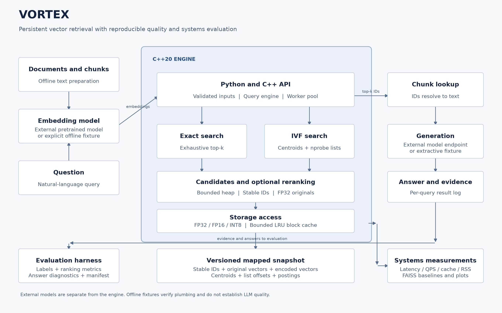
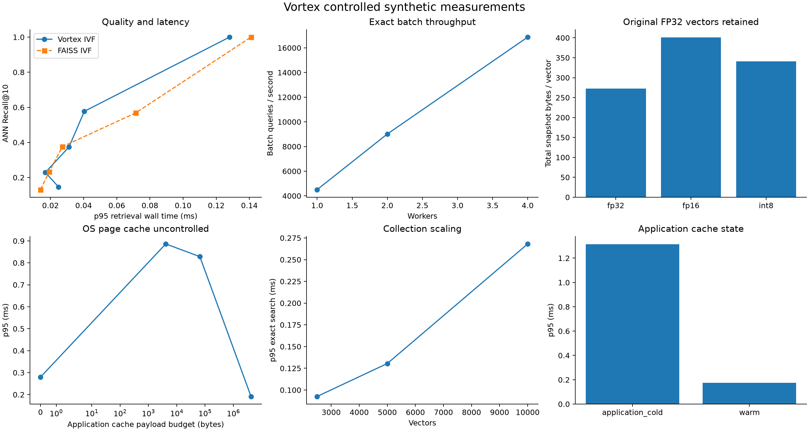
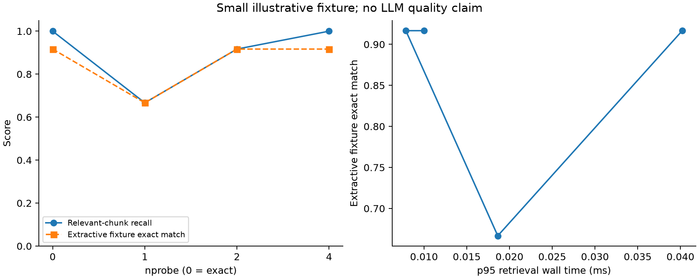
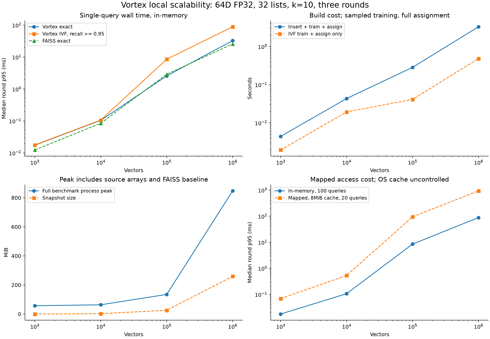

# Vortex

A C++20 vector retrieval engine with custom exact search, IVF indexing, persistent mapped snapshots, and a reproducible evaluation harness. Python bindings connect the engine to a small RAG example.

Vortex implements storage, distance kernels, top-k selection, k-means, IVF lists, quantization, and caching itself. FAISS is used only by the benchmark scripts.

[](assets/system-architecture.svg)

## Capabilities

| Area | Implemented behavior |
| --- | --- |
| Similarity | Squared L2, inner product, normalized cosine; stable ID tie-breaking |
| Search | Exhaustive search, seeded IVF, tunable nprobe, optional original-FP32 reranking |
| CPU | Scalar reference; runtime-dispatched AVX2 on x86 GCC/Clang; reusable batch worker pool |
| Persistence | Versioned little-endian single-file snapshot, validated metadata, read-only file mapping |
| Storage access | Windows file mapping and POSIX mmap; bounded LRU block cache |
| Representation | FP32, FP16, per-vector symmetric INT8; original FP32 vectors retained |
| Python | Strict contiguous float32 inputs; single and batch search; cache statistics |
| Evaluation | Labeled retrieval metrics, per-query evidence, lexical answer diagnostics, run manifests |
| Integration | Offline fixture; optional pinned sentence-transformer embeddings and external HTTP generation |

## Measured release results

One local Windows Release run: Intel Core i7-1255U, GNU 16.1.0, 10,000 vectors x 64 dimensions, 100 queries, k=10, 32 lists, one thread, seed 42. These in-memory query timings include Python binding overhead; mapped/cache experiments are reported separately. This small synthetic run does not establish general superiority or production capacity.

| Configuration | ANN Recall@10 | p95 ms |
| --- | ---: | ---: |
| Vortex exact FP32 | 1.000 | 0.103 |
| Vortex IVF nprobe=4 | 0.374 | 0.031 |
| Vortex IVF nprobe=32 | 1.000 | 0.128 |
| FAISS flat | 1.000 | 0.166 |
| FAISS ivf nprobe=4 | 0.376 | 0.027 |
| FAISS ivf nprobe=32 | 1.000 | 0.141 |

Original FP32 vectors are retained: total snapshots use approximately 273 bytes/vector for FP32, 401 for FP16 and 341 for INT8. In this run the additional encoding increases total storage, and decoding/cache overhead can increase latency.

The fictional 12-query fixture achieves relevant-chunk Recall@3 of 1.000 with exact search and 0.667 with one IVF probe; extractive answer exact match is 0.917 and 0.667 respectively. These are fixture integration results, not real LLM evaluations.





Full measurements, run identity, limitations and reproduction commands are in [the benchmark report](docs/benchmark_results.md). Raw exported evidence is in [benchmarks/reference](benchmarks/reference/).

## Historical in-memory scalability through one million vectors

All four sizes passed locally with synthetic **64D FP32** vectors, top-10 retrieval, 32 IVF lists, 100 queries and three randomized-order rounds. Latency below is the median of the three round p95 values. The IVF operating point uses the smallest tested nprobe reaching mean Recall@10 of at least 0.95 on the measured queries.

| Vectors | Exact p95 ms | IVF p95 ms | IVF Recall@10 | Process peak MiB |
| ---: | ---: | ---: | ---: | ---: |
| 1,000 | 0.017 | 0.018 | 0.991 | 57.1 |
| 10,000 | 0.105 | 0.107 | 0.956 | 63.7 |
| 100,000 | 2.573 | 8.555 | 0.971 | 134.8 |
| 1,000,000 | 32.575 | 88.578 | 0.978 | 847.2 |

The million-vector insertion and IVF build took 3.299 seconds. Process peak memory includes input arrays, builders, reference calculations and the FAISS baseline. High-recall IVF is slower than exact search in this fixed configuration. The reopened million-vector snapshot with an 8 MiB application cache measured **936.460 ms p95** on a 20-query subset; the OS page cache was not flushed.

This establishes local million-vector capacity at 64 dimensions. It does not establish the same behavior at 768 dimensions or production load. The input generator and query set differ from the initial 10k run above, so timings from the two experiments should not be combined into one scaling curve.



See the [methodology and complete results](docs/scalability.md) and [recorded evidence](benchmarks/reference/scaling/). To validate or regenerate the published tables without repeating the large run:

```bash
python benchmarks/validate_scaling.py
python benchmarks/report_scaling.py --output-dir results/scaling-report
```

To collect new measurements, install the benchmark extra and select an unused output directory:

```bash
python benchmarks/run_scaling.py --output results/scaling-new
python benchmarks/report_scaling.py --input-dir results/scaling-new --output-dir results/scaling-new/report
```

`--sizes` selects a subset, and existing result files are never overwritten. The runner isolates each size in a child process and reports nonzero status if any size fails or cannot meet its memory-headroom check. It requires no cloud service.

## One mapped collection at ten million vectors

One **10,000,000-vector, 64D FP32** collection completed locally using a new streaming snapshot writer and the unchanged native query engine. A fresh 1m control used the same construction protocol, twenty independent queries, three timing rounds, 32 IVF lists, an 8 MiB application cache and a requested 1536 MiB Windows process working-set limit. Latency is median round p95; these mapped results belong to a separate experiment from the historical in-memory curve.

| Vectors | Construction s | Exact p95 ms | Selected IVF p95 ms | Recall@10 | nprobe | Observed peak MiB |
| ---: | ---: | ---: | ---: | ---: | ---: | ---: |
| 1,000,000 | 2.734 | 233.142 | 1151.608 | 0.985 | 28 | 382.172 |
| 10,000,000 | 36.145 | 4003.070 | 23053.437 | 0.980 | 24 | 1536.016 |

The 10m snapshot is **2.72 GB**. Every exact query scanned all ten million vectors; FAISS checked all twenty queries over the complete corpus, three also used direct float64 NumPy, and all-list IVF matched exact IDs and scores. Both sizes completed all 480 measurements. High-recall IVF remains slower than exact in this fixed configuration. The process limit covers resident pages; commit and the total OS file cache are additional resource measures. Windows peak accounting exceeded the requested maximum by 16 KiB, retained in the reported peak.

One final all-list sample recorded 3832.125 seconds wall time versus 35.797 seconds CPU. Its cause is unconfirmed; the sample is retained and that condition's latency is flagged as interrupted. The exact and selected-IVF conditions contain no flagged wall/CPU gaps. The earlier duplicate-buffer and unrestricted-mapped resource stops are also preserved.

See [method, results and limitations](docs/capacity_10m.md) and [compact evidence and diagnostics](benchmarks/reference/capacity/report.md). Validate the evidence without regenerating the large snapshots:

```bash
python benchmarks/validate_capacity.py --directory benchmarks/reference/capacity
```

New full runs use `python benchmarks/run_capacity.py --size 10000000 --working-set-mib 1536 --output results/capacity-new` on Windows. The native mutable builder is unchanged; this establishes single-collection mapped retrieval at 64D with streamed construction.

## Build and test

Requirements: Python 3.10+, a C++20 compiler, and CMake 3.20+. No vector database is required. Build dependencies for Python packaging are installed automatically.

```bash
python -m venv .venv
# Activate .venv using the command appropriate for your shell.
python -m pip install ".[test,benchmark]"
python -m pytest -q
python examples/quickstart.py
python eval/run_eval.py
```

For native development:

```bash
python -m pip install cmake ninja pybind11
cmake -S . -B build -DCMAKE_BUILD_TYPE=Release
cmake --build build --config Release --parallel 4
ctest --test-dir build -C Release --output-on-failure
```

The native library has no third-party runtime algorithm dependencies. The Python extension is optional for the CMake build. Enable it with `-DVORTEX_PYTHON=ON`; the standard package installation builds it automatically.

On Windows, the build configuration targets MSVC; this release was exercised locally with MinGW-w64. Put the MinGW compiler on PATH, use the Ninja generator, and select it with `-DCMAKE_CXX_COMPILER=g++`. For package builds, set the `CMAKE_ARGS` environment variable to that compiler option and `CMAKE_GENERATOR=Ninja`. MinGW runtime libraries are linked statically. The explicit AVX2 implementation is enabled for GCC/Clang; MSVC uses the scalar fallback.

Linux sanitizer build:

```bash
cmake -S . -B build-sanitize -DCMAKE_BUILD_TYPE=Debug -DVORTEX_SANITIZERS=ON
cmake --build build-sanitize --parallel 4
ctest --test-dir build-sanitize --output-on-failure
```

## Python usage

```python
import numpy as np
from vortex import Index

index = Index(3, metric="cosine", threads=2)
index.add(100, np.array([1, 0, 0], dtype=np.float32))
index.add(200, np.array([0, 1, 0], dtype=np.float32))
index.build_ivf(nlist=2, seed=42)
index.save("data/example.vtx")

opened = Index.open("data/example.vtx", cache_bytes=8192, threads=2)
result = opened.search(np.array([1, 0, 0], dtype=np.float32), k=1, nprobe=2)
print(result)  # hits, scanned vectors, native elapsed milliseconds
```

`nprobe=0` selects exhaustive search. Positive nprobe searches that many IVF lists. `rerank_n=0` disables reranking; otherwise it must be at least k. Scores are ascending squared distances for L2 and descending similarities for inner product/cosine. All ties use ascending stable IDs.

`search_batch` parallelizes queries across a fixed worker pool. Single-query searches run on the calling thread. Inputs are copied while the Python GIL is held, then native work releases it.

Builders accept inserts. An insert invalidates existing IVF state; exhaustive search remains available, while IVF search and saving require rebuilding. Reset the representation to FP32 before further inserts. Reopened snapshots are immutable; use a new builder to create a changed collection.

## Architecture and storage

Offline ingestion produces chunk IDs and embeddings. The C++ engine stores those vectors and builds IVF lists. At query time it normalizes the query where needed, selects an exact scan or IVF lists, retains top candidates, optionally reranks with originals, and returns IDs. Python resolves IDs to text and supplies that evidence to the generator.

The snapshot contains IDs, original FP32 vectors, optional encoded vectors, centroids, offsets, and postings. Vectors remain mapped after opening; IDs, centroids, and postings are loaded into memory. The cache budget applies to cached block payload only. It is not a cap on total process memory or operating-system file caching.

Saving writes a complete sibling temporary file before replacing the destination. There is no WAL, transaction system, or power-loss durability guarantee. Windows may reject replacement while a destination is actively mapped; close its readers or publish under a new name. Failures preserve the previous snapshot.

See [file format](docs/file_format.md), [design decisions](docs/architecture.md), and [verification checklist](docs/verification.md).

## Benchmarks and evaluation

```bash
python benchmarks/run_benchmarks.py --vectors 10000 --dimension 64 --queries 100
python eval/run_eval.py --nprobe 0 1 2 4
python benchmarks/plot_results.py --evaluation results/eval/summary.json
```

Raw runtime output is written under ignored `results/`. Each run records configuration, dataset fingerprint, source fingerprint, Git revision and dirty state, package versions, and hardware. The manifest records whether compiler/build information was supplied. Set `VORTEX_BUILD_DESCRIPTION` to the actual compiler flags and build configuration when collecting results for publication.

ANN recall compares approximate neighbors with exhaustive neighbors. Labeled relevance recall measures whether document evidence is retrieved; these answer different questions. Latency percentiles are sequential query wall times. Batch throughput is measured separately. Application cache misses are not physical SSD reads.

The 16-chunk, 12-query support fixture is fictional and illustrative. The default embedding hashes tokens, and its generator extracts a sentence. Answer exact match/token F1, lexical support, and conservative verbatim sentence support validate this pipeline, not real LLM correctness or semantic faithfulness. A support score of 1 can coexist with a wrong answer.

For real model integration, install `.[embeddings]`, use `--embedding sentence-transformers`, and supply both `--embedding-model` and a pinned `--embedding-revision`. Select `--generator http` and set `VORTEX_GENERATION_URL` and `VORTEX_GENERATION_MODEL`. The endpoint accepts a JSON model/prompt request and returns an `answer` or `response` string. The adapter requests temperature 0 and seed 42; endpoint compliance must be checked separately. External model execution requires the relevant packages, model access, and endpoint.

See [evaluation methodology](docs/evaluation.md) and the measured release results above.

## Real model RAG quality

One local CPU experiment used commit-pinned all-MiniLM-L6-v2 embeddings and the
existing Gemma 3 1B Q4_K_M model. Development tuning used 50 answerable and 10
source-unanswerable training questions. Held-out evaluation used 150 answerable
and 30 source-unanswerable questions from public SQuAD 2.0 development data,
with 1,767 indexed chunks and five generation conditions.

| Condition | Answer token F1 | Answer exact match |
| --- | ---: | ---: |
| No context with the evidence-only prompt | 2.85% | 0.67% |
| Source-evidence oracle | 59.94% | 39.33% |
| Exact FP32 retrieval | 43.53% | 26.67% |
| Selected FP32 IVF | 43.29% | 26.67% |
| Selected INT8 IVF with FP32 reranking | 43.29% | 26.67% |

These answer metrics use all 150 answerable questions per condition. All 900
held-out HTTP requests completed, with zero retries. Sixteen citation-only answers were
retained and scored zero. The exact condition's article-bootstrap 95% interval
for answer F1 is 36.60% to 50.75%.

Exact labeled Recall@5 was 82.67%, with Hit@5 of 84%. The development quality
gates selected full-list probing for IVF and INT8 reranking. These configurations
matched the exact top-five neighbors on all 180 test queries. Identical prompts
produced 21 differing normalized answers across the exact/IVF pairs despite the
requested temperature and seed. Their small answer-score difference includes
runtime output variation.

Abstention and citation use need attention. The source-evidence oracle emitted
the required insufficient-evidence marker on 1 of 30 source-unanswerable cases.
Only 6 of 175 substantive exact-retrieval responses included citations, although
all eight citation mentions used supplied IDs. Contexts were truncated in 95 of
180 exact-retrieval records. Human semantic and citation review is pending at the
owner's request. Source-unanswerable labels apply to the original paragraph,
and public data can overlap model pretraining.

See the [recorded results and provenance](eval/reference/real-rag/),
[reproduction and scoring method](docs/real_rag.md), and
[frozen experiment specification](eval/real_rag_spec.md).

## CPU embedding comparison

Four pinned local encoders completed held-out retrieval on a fresh SQuAD subset
and a scientific evidence workload. Each domain has 150 positive test queries;
SQuAD also has 30 separately scored paragraph-negative questions. SciFact uses a
label-informed, shared 1,000-document corpus, so these are restricted-corpus
results rather than standard full-BEIR scores. Native vector dimensions differ.

| Encoder | Dimensions | SQuAD Recall@10 | SQuAD nDCG@10 | SciFact Recall@10 | SciFact nDCG@10 |
| --- | ---: | ---: | ---: | ---: | ---: |
| MiniLM L6 v2 | 384 | 91.33% | 75.55% | 90.20% | 80.85% |
| Qwen3 Embedding 0.6B | 1024 | 97.33% | 87.83% | 91.33% | 82.37% |
| Jina v5 text nano | 768 | 97.33% | 88.17% | 94.00% | 85.49% |
| EmbeddingGemma 2 | 768 | 96.67% | 83.35% | 95.33% | 87.73% |

These are exact FP32 cosine results, independently checked against normalized
float64 NumPy scores. Jina has the highest SQuAD mean and EmbeddingGemma the
highest restricted SciFact mean. Source-group bootstrap intervals and paired
differences are in the evidence; descriptive leaders do not establish a universal
ranking. Jina's weights have a noncommercial license.

Development-only selection chose EmbeddingGemma 2 and Jina nano as the RAG
challengers alongside MiniLM. Voyage 4 large and Gemini embedding 2 remain
pending by owner decision, with zero API calls or charges. Human semantic and
citation review remains pending.

On the common 50-positive-question RAG subset, answer token F1 was 41.30% for
MiniLM, 43.84% for Jina and 38.03% for EmbeddingGemma, versus 60.69% with source
oracle evidence and 3.08% without context. Both challengers' paired F1-difference
intervals include zero; an answer-quality improvement is not established.
All 350 main/repeated requests and the separate 30-request smoke run completed.
Seven of 75 identical-prompt pairs produced different normalized answers.

Only three of eight selected ANN settings retained both development quality
gates on held-out Recall@10 and neighbor recall. Five missed at least one gate;
settings were preserved rather than retuned on test. The quality findings above
and the RAG experiment use exact retrieval. Substantive retrieved answers also
rarely included citations, so semantic correctness and attribution remain open.

Primary timing observations retain system sleep and Modern Standby interruptions,
including three extreme Qwen SQuAD batches. Full-corpus elapsed throughput must
not be treated as steady CPU speed. A separate sampled timing audit records
elapsed and process CPU time, power state, actual parameter precision, devices
and threads without changing primary vectors or quality selections.
The supplemental larger-model runs recorded battery power, while MiniLM recorded
AC power; these timings are not a controlled comparison at matched power.

See the [methodology and reproduction commands](docs/embedding_comparison.md),
[frozen specification](eval/embedding_comparison_spec.md), and
[aggregate results and checksums](eval/reference/embedding-comparison/).
The earlier real-RAG experiment above uses different questions and chunking;
its answer scores are not a controlled comparison with this study.

## Limitations

- Original FP32 vectors are retained for reranking. FP16/INT8 reduce the encoded search payload but increase total snapshot size in this release.
- Encoded vectors are decoded before scoring; FP16 conversion and cache locking can dominate latency.
- Compressed cosine uses approximate dot products of quantized normalized vectors; it does not renormalize each decoded vector.
- The native mutable builder constructs indexes in memory. The large-capacity benchmark separately streams FP32 snapshots, trains on a bounded sample and assigns every vector; it does not extend the mutable builder's memory capacity.
- Metadata remains in RAM, and the OS controls mapped-page residency. Application-cold benchmarks do not flush the OS cache.
- Metadata headers are checksummed; full vector payload integrity is not checksummed. Non-finite fetched values are rejected.
- HNSW, PQ, GPU support, online index maintenance, filtering, distributed search, and crash recovery are future work.

## Verification status

Local Windows GCC Release and Debug tests pass, including 63,666 native assertions. The expanded Python suite has 101 passing tests, including nine capacity regressions and the existing embedding-study, scaling and real-RAG checks. Public comparison checksums, dataset separation, vector archives and official answer scoring also pass validation. The original release passed a separate fresh-checkout check of the native suite, installed package, quick start and offline evaluation.

[Hosted CI run 43010051379](https://github.com/atharvasheersh/Vortex/actions/runs/43010051379) passed on 11 November 2026 for code revision `2523b30`: Windows/MSVC native tests and all 101 Python tests, Linux native tests and 100 Python tests with one Windows-only skip, and the Linux sanitizer build/test job. Quick start, fixture evaluation and public RAG/embedding evidence validation also passed on both platforms. The earlier account-blocked run is historical. Local MinGW still lacks its sanitizer runtime; the sanitizer evidence comes from Linux CI.

## Development layout

`include/` and `src/` contain the engine; `python/` contains bindings and integration; `tests/` contains native and Python checks; `eval/` contains the labeled fixture and runner; `benchmarks/` contains controlled sweeps and plots; `assets/` contains the diagram and public plots.

Regenerate the editable SVG and PNG with `python tools/render_architecture.py` after installing the benchmark extra.
