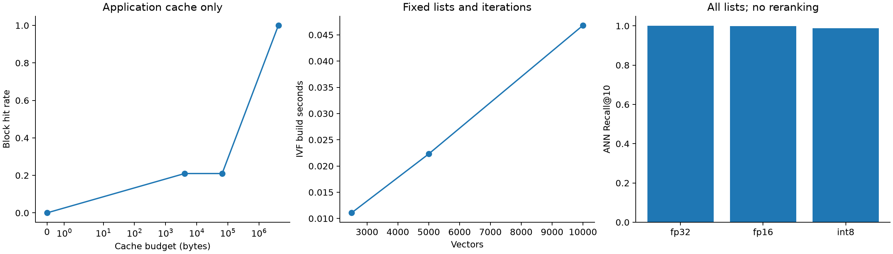

# Measured benchmark report

This report preserves one local synthetic run and its source identity. It is a reproducible engineering example, not a statistical comparison on representative production embeddings.

## Run identity

- Executable source revision: `a86ccff48f1adb7f40a0fe82c141a2a446e5ad19`.
- Source SHA-256: `b7ea5717e5ace6d43c39475c4fa891b3f2be1c7cd8aeab75bff15569d25073e1`.
- Working tree was clean when results were collected.
- Dataset SHA-256: `16f3b35c350b6807435d21e9ee346bfa2df3057c706c03ec01749f43acf6dcee`.
- Corpus: 10,000 independent normal-distributed float32 vectors, dimension 64; 100 independent queries; k=10; seed 42.
- CPU: Intel Core i7-1255U; Windows x86-64; GNU 16.1.0 MinGW-w64 UCRT; CMake Release with -O3 and no fast-math. AVX2 available.
- FAISS uses one thread and the same arrays, L2 metric, list count and clustering iteration count. Cluster training implementations differ.
- The manifest includes exact package versions and process-wide peak working set. This memory peak includes Python, arrays, builders, mapped pages and FAISS and cannot be attributed to one index configuration.

## In-memory exact and IVF results

| Configuration | ANN Recall@10 | p95 ms |
| --- | ---: | ---: |
| Vortex exact FP32 | 1.000 | 0.103 |
| Vortex IVF nprobe=4 | 0.374 | 0.031 |
| Vortex IVF nprobe=32 | 1.000 | 0.128 |
| FAISS flat | 1.000 | 0.166 |
| FAISS ivf nprobe=4 | 0.376 | 0.027 |
| FAISS ivf nprobe=32 | 1.000 | 0.141 |

Compare at similar recall. Matching nprobe alone does not make different trained indexes equivalent. Sequential query latency and batch throughput are measured independently. Percentiles and throughput are from a single process run in a fixed configuration order; hardware load, cache state and timing noise can affect comparisons.

## Representation and mapped access

| Representation | Total bytes/vector | All-list ANN recall | Mapped p95 ms |
| --- | ---: | ---: | ---: |
| fp32 | 272.9 | 1.000 | 2.730 |
| fp16 | 400.9 | 0.999 | 13.302 |
| int8 | 340.9 | 0.988 | 4.473 |

Every compressed snapshot retains original FP32 vectors. Reported size includes those originals, metadata and postings. FP16 decoding and explicit cache locking can be expensive. The measured collection exceeds the configured small application cache, but is much smaller than physical RAM.



Application-cold trials clear the explicit cache before every query. The OS page cache is not flushed. Mapped bytes fetched count copied bytes, not physical SSD reads. Cache payload limits exclude container overhead, metadata and temporary decoding buffers.

## Illustrative RAG fixture

| Search | Relevant Recall@3 | MRR@3 | Extractive exact match | Verbatim sentence support |
| --- | ---: | ---: | ---: | ---: |
| exact | 1.000 | 0.903 | 0.917 | 1.000 |
| IVF 1 | 0.667 | 0.667 | 0.667 | 1.000 |
| IVF 2 | 0.917 | 0.875 | 0.917 | 1.000 |
| IVF 4 | 1.000 | 0.903 | 0.917 | 1.000 |

The 16 chunks and 12 questions are project-authored fictional support facts. Hashed token embeddings and sentence extraction are explicit fixtures. The support diagnostic can be perfect while the answer is wrong for the question; no semantic faithfulness or real-model correctness claim follows. Optional pretrained-model and HTTP generation execution remain separate verification work.

## Reproduce

```bash
python -m pip install ".[test,benchmark]"
python -m pytest -q
python benchmarks/run_benchmarks.py
python eval/run_eval.py
python benchmarks/plot_results.py --evaluation results/eval/summary.json
```

Set VORTEX_BUILD_DESCRIPTION to the actual compiler/build configuration. New timings will vary. Preserve the generated manifests and query logs with any reported result.

The native microbenchmark export uses the same source revision and compiler configuration, but 10,000 vectors x 128 dimensions and 200 queries. It measures native search time with scalar then auto dispatch and should not be mixed with the Python wall-time table above.

## Evidence files

- [Engine JSON](../benchmarks/reference/measurements.json) and [CSV](../benchmarks/reference/measurements.csv).
- [FAISS measurements](../benchmarks/reference/faiss.json).
- [Systems manifest](../benchmarks/reference/manifest.json).
- [Fixture summary](../benchmarks/reference/fixture-summary.json), [manifest](../benchmarks/reference/fixture-manifest.json) and [per-query records](../benchmarks/reference/fixture-queries.jsonl).
- [Native microbenchmark CSV](../benchmarks/reference/microbench.csv).
