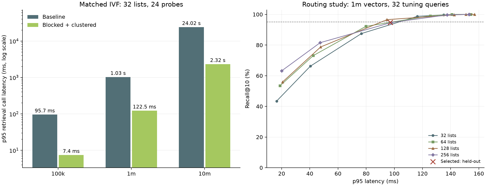

# Retrieval performance optimization

Vortex now supports bounded contiguous mapped scans, version-1 snapshots packed
by IVF list, and fused INT8 distance scoring. The primary matched 10m comparison
measured **10.36x IVF p95 speedup (90.3% lower latency)**
with identical returned neighbors, identical candidates scanned, and **98.1% Recall@10**.
This is a local synthetic 64D result, not a production-service or RAG-answer claim.



## Before and after

| Collection | Retrieval | Baseline p95 ms | Optimized p95 ms | Speedup | Latency reduction | Optimized Recall@10 |
| --- | --- | ---: | ---: | ---: | ---: | ---: |
| 100k | Exhaustive FP32 | 20.881 | 9.012 | 2.32x | 56.8% | 100.0% |
| 100k | IVF 24/32 | 95.749 | 7.421 | 12.90x | 92.2% | 95.8% |
| 1m | Exhaustive FP32 | 189.775 | 154.000 | 1.23x | 18.9% | 100.0% |
| 1m | IVF 24/32 | 1025.669 | 122.473 | 8.37x | 88.1% | 97.6% |
| 10m | Exhaustive FP32 | 3612.023 | 3668.744 | 0.98x | -1.6% | 100.0% |
| 10m | IVF 24/32 | 24024.856 | 2319.843 | 10.36x | 90.3% | 98.1% |
| real-minilm | Exhaustive FP32 | 1.199 | 1.019 | 1.18x | 15.0% | 100.0% |
| real-minilm | IVF 24/32 | 0.804 | 0.928 | 0.87x | -15.4% | 100.0% |

Observed 10m exhaustive p95 was 1.6% higher after the
changes; this study does not establish an exhaustive-search speedup at that size.

Primary latency is wall time around the complete Python `Index.search` call,
including binding preparation and returned-result conversion. It excludes
embedding, HTTP, answer generation, reference scoring and checkpoint writes.
p95 is computed over all saved calls, using linear interpolation. Round p95,
p50, mean, sequential query-call QPS and candidate counts are in the archive.
Sequential QPS excludes validation/checkpoint overhead and is not batch throughput.

The 100k/1m and cached-real-vector conditions use 100 held-out query IDs over
three shuffled rounds. The 10m conditions use 32 held-out query IDs over one
round, following the pilot-budget amendment recorded before final collection.
Three warmups precede each condition. Queries repeated across rounds are not
additional independent samples. Synthetic query seed is 20261120, separate from
corpus/training seeds. Tuning uses IDs 0–31; evaluation starts at ID 32.

## What changed and what caused the improvement

1. The old mapped FP32 path acquired the cache mutex and copied a temporary
   vector for every candidate. The new path reads contiguous runs in bounded
   tiles (normally at most 64 KiB; one vector for dimensions larger than that),
   amortizing lock and metadata work. Every scored FP32 component still undergoes
   finite-value validation. Bounds checks and read-only ownership remain intact.
2. `save(path, clustered=True)` writes each IVF list's vectors together while
   preserving public IDs, centroids, assignments and the version-1 format. The
   existing default save behavior remains compatible. The standalone repacker
   converts old snapshots with bounded component buffers and no in-place changes.
3. INT8 scoring fuses code conversion/scaling into scalar or AVX2 distance loops,
   avoiding a complete decoded FP32 vector and per-vector encoded-buffer
   allocation. Conversion occurs in registers; this is not an integer-only dot
   product or product quantization. Scales, non-finite decoded values and
   accumulation overflow remain checked. FP32 originals support final reranking.
4. Cache statistics now expose `read_calls`, and the native diagnostic reports
   the selected compiled distance kernel. GNU/Clang x86 builds can select AVX2;
   the MSVC implementation currently retains its scalar fallback.

The locality-only condition runs the unchanged baseline binary against the
packed snapshot. Storage-only runs the optimized binary against the original
layout. This separates physical-layout effects from engine changes.

| Collection | Baseline IVF p95 ms | Storage only | Locality only | Combined |
| --- | ---: | ---: | ---: | ---: |
| 100k | 95.749 | 101.400 | 8.636 | 7.421 |
| 1m | 1025.669 | 1013.588 | 127.751 | 122.473 |
| 10m | 24024.856 | Not run | 2712.132 | 2319.843 |

## Quality, uncertainty and routing

| Collection | Combined IVF speedup | Paired-query bootstrap 95% interval | Distinct queries | Rounds |
| --- | ---: | --- | ---: | ---: |
| 100k | 12.90x | [11.83x, 13.92x] | 100 | 3 |
| 1m | 8.37x | [8.20x, 8.67x] | 100 | 3 |
| 10m | 10.36x | [9.79x, 10.95x] | 32 | 1 |

Intervals resample query IDs while retaining their rounds together (1,000
bootstrap samples). They describe these fixed corpora and collected timings;
they do not capture different machines, operating conditions or production load.
The single 10m round provides no repeated-round tail-stability evidence.

The 32/64/128/256-list study selected 128 lists and 64 probes using only the
32-query tuning split. Its held-out Recall@10 was **94.8%**, below
the declared 95% threshold. That failed generalization is retained and is not
recommended as a validated operating point. No held-out retuning was performed.
The primary comparison keeps the historical fixed 32-list/24-probe setting.

The exact reference uses blocked FAISS over every corpus row, with three
additional full-corpus float64 checks per dataset. All timed FP32 exhaustive
queries must agree with the independent reference. Matched variants must return
identical ordered IDs/scores and scan counts. Reference collection time is not
a FAISS latency baseline.

The real-vector check reuses 3,328 cached 384D MiniLM SciFact vectors and existing
query embeddings. It measures ANN neighbor retrieval on those cached vectors;
it does not rerun or establish document relevance, answer F1 or semantic review.
No encoder or generator was downloaded or called.

## Compression and resource costs

| 1m condition | Baseline p95 ms | Optimized p95 ms | Speedup | Recall@10 |
| --- | ---: | ---: | ---: | ---: |
| Exhaustive INT8 + rerank 100 | 201.520 | 65.576 | 3.07x | 100.0% |
| IVF INT8 + rerank 100 | 148.844 | 49.879 | 2.98x | 97.6% |

An **optional exploratory 10m INT8 expansion** ran after the primary experiment
completed, using the remaining declared budget and the same fixed 24 probes,
100-candidate reranking and 32 held-out queries. It was not used to select the
primary FP32 configuration, and it adds no independent query sample.

| 10m INT8 condition | p95 ms | Recall@10 |
| --- | ---: | ---: |
| Baseline decoder, packed layout | 1515.278 | 98.1% |
| Fused scoring, packed layout | 534.153 | 98.1% |

The codec-only paired speedup is 2.84x.
Compared with the original FP32 IVF condition, this exploratory combination
measured 44.98x lower p95 latency;
ordered FP32 result equality on these queries: **True**. That cross-track
comparison also changes representation and reranking and was not interleaved
with the primary conditions. It is kept separate from the primary matched FP32
claim. The extra preparation/export/query phase took 136.5s,
with 64 additional calls. The INT8 snapshot retains originals and occupies 3.4 GB.

Both INT8 variants use the same packed encoded bytes and rerank 100 candidates
against retained FP32 originals. Exhaustive INT8 scanning is still an approximate
representation stage; observed recall does not prove exact FP32 equivalence for
all future queries. FP16 was measured separately as an eight-query tuning pilot
at 100k; its existing conversion-heavy scoring path was not promoted as a speed
optimization. See the saved records for all positive and negative results.

| Condition (representative first round) | Whole snapshot GB | Peak process working set MiB |
| --- | ---: | ---: |
| 1m-baseline-r0 | 0.272 | 368.437500 |
| 1m-optimized-r0 | 0.272 | 368.363281 |
| 1m-int8-optimized-r0 | 0.340 | 222.617188 |
| 10m-baseline-r0 | 2.720 | 1536.011719 |
| 10m-optimized-r0 | 2.720 | 1536.015625 |

Every matched run requests the same Windows 1536 MiB process working-set maximum.
Actual peaks are retained; an explicit 64 KiB accounting allowance follows the
existing capacity policy. This does not bound committed memory or total OS file
cache. The 8 MiB application cache is another distinct measure. Larger corpus
metadata still scales with N; bounded conversion buffers do not imply constant
total process memory.

INT8/FP16 snapshots retain originals and therefore increase total disk size,
even though their hot scoring payload is smaller. Packing requires a second
output file and a one-time conversion. Construction/conversion timing and
training details are saved separately; the early 10m packing timer included
payload repacking and final validation/hash, but excluded initial validation/hash.
It must not be read as total conversion elapsed time.

## Reproduce and use

Install the current checkout with `python -m pip install ".[test,benchmark]"`.
On the measured Windows MinGW host, select Ninja and the compiler explicitly.
The existing environment uses uv rather than an installed pip module:

```powershell
$env:CMAKE_GENERATOR = "Ninja"
$env:CXX = "C:/msys64/ucrt64/bin/g++.exe"
$env:PATH = "$PWD/.venv/Scripts;C:/msys64/ucrt64/bin;$env:PATH"
uv pip install --python .venv/Scripts/python.exe scikit-build-core
uv pip install --python .venv/Scripts/python.exe --no-deps --no-build-isolation .
```

For a normal mutable IVF builder:

```python
index.build_ivf(32)
index.save("collection-packed.vtx", clustered=True)
opened = Index.open("collection-packed.vtx")
hits = opened.search(query, k=10, nprobe=24)
```

For an existing snapshot (use a fresh destination):

```bash
python benchmarks/repack_snapshot.py original.vtx packed.vtx
python benchmarks/encode_snapshot.py packed.vtx packed-int8.vtx --dtype int8
python benchmarks/run_performance.py reference --snapshot original.vtx --output results/new-reference --seed 20261120
python benchmarks/run_performance.py measure --snapshot packed.vtx --reference results/new-reference --output results/new-measurement --query-offset 32 --query-count 100 --probes 0,24 --working-set-mib 1536
python benchmarks/validate_performance.py --directory benchmarks/reference/performance
```

To rebuild baseline and optimized modules without replacing either installation:

```bash
git worktree add --detach .work/performance-old c2fdefc
python -m pip install --no-deps --no-build-isolation --target .work/native-baseline .work/performance-old
python -m pip install --no-deps --no-build-isolation --target .work/native-optimized .
python benchmarks/prepare_performance_data.py --output results/repro-1m --count 1000000 --working-set-mib 1536
python benchmarks/repack_snapshot.py results/repro-1m/collection.vtx results/repro-1m/packed.vtx
python benchmarks/run_performance.py reference --snapshot results/repro-1m/collection.vtx --output results/repro-1m/reference --seed 20261120
python benchmarks/run_performance.py measure --snapshot results/repro-1m/collection.vtx --reference results/repro-1m/reference --output results/repro-1m/baseline-r0 --module-dir .work/native-baseline --round-id 0 --probes 0,24
python benchmarks/run_performance.py measure --snapshot results/repro-1m/packed.vtx --reference results/repro-1m/reference --output results/repro-1m/optimized-r0 --module-dir .work/native-optimized --round-id 0 --probes 0,24
```

Use fresh output names for rounds 1 and 2 and interleave variants as recorded by
the study driver. For the declared 10m track, prepare 10,000,000 rows, collect a
64-query reference, and measure 32 held-out queries in one round. For routing,
prepare 32/64/128/256 lists with training limits 10000/10000/10000/16384, then
use query offset 0/count 32 and the probe grids saved in `tuning.json`.
Rebuilding produces new module hashes, which belong to that new experiment;
byte-identical historical binaries are not assumed.

On other operating systems use `--working-set-mib 0`; that is a different,
OS-managed memory track and must not be presented as the Windows bounded result.
The full study driver accepts prepared study data, separate baseline/optimized
module directories, and a new output directory. It records its condition plan
before running, shuffles conditions by round, runs one worker at a time, and
preserves failures/timeouts. See `benchmarks/performance_protocol.md` and
`benchmarks/run_performance_study.py --help`.

Baseline native revision: `c2fdefc`; optimized native revision: `1b0de43`.
The archive identifies both actual module hashes and measured source bytes.
Collectors can run from a newer working tree than the baseline binary; the
collector-tree revision is not the baseline native-source revision.
Large snapshots and raw local output remain ignored under `results/`.

## Verification and remaining limits

The compact archive retains 8,924 final calls, 768 routing-tuning calls, query
matrices, independent references, per-condition manifests, bootstrap comparisons,
construction metadata and measured source snapshots. Its validator recomputes
metrics, recall, split coverage, pair agreement, source fingerprints and policy
checks; tests also reject rehashed tampering. Historical capacity, scaling,
embedding and RAG archives remain unchanged.

The separate optional INT8 expansion retains another 64 calls. Executed collector
and conversion bytes are frozen in the archive. Maintained helpers subsequently
received edge-case hardening for zero-only INT8 rows, requested scalar diagnostics
and invalid time budgets; those fixes do not change the recorded Gaussian data
or all-auto measurement conditions.

Final local test results are recorded in `docs/verification.md`. The current
optimization has local Windows and Ubuntu sanitizer evidence; earlier hosted
runs belong to their recorded revisions. Publishing/running new hosted CI is
separate from local validation.

Cache state is warmed/OS-managed, not controlled cold-cache. Background desktop
load, CPU scheduling and power behavior are not fully controlled. Timing gaps
are retained and flagged. The baseline is Vortex's previous implementation;
this is not evidence of outperforming FAISS or another external engine.
The 10m result applies to 64D synthetic vectors and the measured memory policy,
not arbitrary 10m real embedding collections.

Existing batch parallelism was profiled separately. Per-query threading and
product quantization were deferred: physical locality was the demonstrated
large bottleneck, while adding them would introduce additional correctness,
memory and scheduling tradeoffs. A graph-based index remains a future experiment
if fewer candidates are needed at high recall.

CV wording supported by this study:

> Reduced p95 IVF retrieval latency by 90.3% (10.36x)
> on a 10-million-vector, 64D synthetic benchmark, preserving identical results
> and 98.1% Recall@10 under a matched 1536 MiB process working-set policy.
