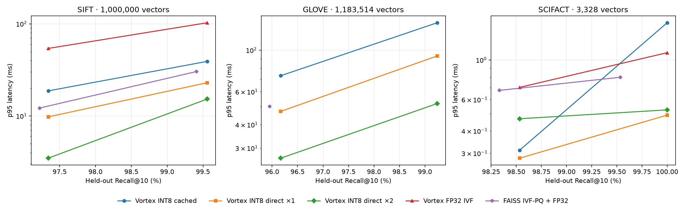
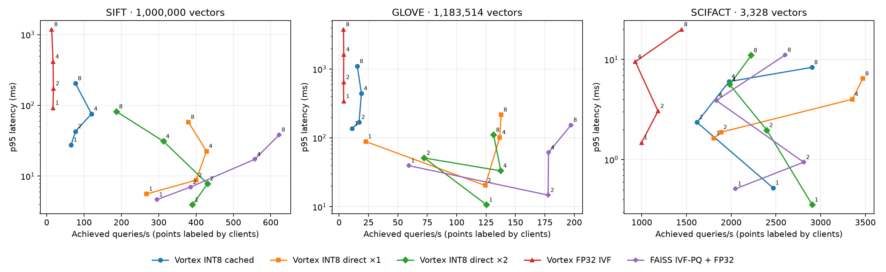

# Vortex retrieval benchmark on real workloads

This study tests when direct INT8 scanning reduces retrieval latency and
what happens to throughput and CPU work as clients share the engine.
The historical 543.04 ms to 151.66 ms result came from 64 synthetic queries
and is documented separately. This study follows a predeclared protocol.
[Previous report](retrieval_speed_phase2.md) · [Current protocol](../benchmarks/real_workloads_protocol.md).

Two-worker direct INT8 reduced serial p95 from **39.14 ms to 13.92 ms**
on SIFT1M and **144.66 ms to 49.55 ms** on GloVe-100 across three
1,000-query rounds. Recall@10 was **99.56%** and **99.24%**, respectively.
All matched cached and direct INT8 cases returned identical ordered
IDs and scores. Under eight-client load, one worker served more queries
per second on both datasets. Its latency advantage depended on the corpus.

## Workloads and references

| Workload | Base vectors | Dimension | Distance | Reference |
| --- | ---: | ---: | --- | --- |
| SIFT1M | 1,000,000 | 128 | Squared L2 | Published top ten with independent spot checks |
| GloVe-100 | 1,183,514 | 100 | Cosine order via unit normalization and squared L2 | Published top ten with independent spot checks |
| MiniLM SciFact cache | 3,328 chunks from 1,000 source documents | 384 | Cosine order via unit normalization and squared L2 | Independent exact top ten plus official document qrels |

SIFT and GloVe vectors, test queries and exact reference IDs come from
the ANN-Benchmarks distribution.
[ANN-Benchmarks datasets](https://github.com/erikbern/ann-benchmarks#data-sets).

SciFact reuses the project’s cached all-MiniLM-L6-v2 vectors and the
BEIR release. The cache covers
150 of the 300 official test queries and a selected part of the official
corpus. Its nDCG and document recall apply to this subset. The cache uses
50 separate development queries for tuning. The corpus is the same for
development and test. Raw data and indexes stay in ignored local storage
with source names, byte counts and hashes.
[BEIR release](https://github.com/beir-cellar/beir).

Stanford lists the source GloVe vectors under PDDL 1.0. The ANN-Benchmarks
preparation code uses the Twitter 27B release.
[Stanford release terms](https://nlp.stanford.edu/projects/glove/) · [ANN-Benchmarks preparation code](https://github.com/erikbern/ann-benchmarks/blob/main/ann_benchmarks/datasets.py#L194).

Allen AI lists the SciFact claims and annotated evidence under CC BY 4.0
and the corpus abstracts under ODC-By 1.0.
[SciFact license](https://github.com/allenai/scifact/blob/master/LICENSE.md).

SIFT1M comes from the INRIA research release. Its specific redistribution
terms remain unverified. The descriptors and derived indexes stay local.
[INRIA Corpus TexMex](http://corpus-texmex.irisa.fr/).

### Resource-gated workloads

The 9,990,000-vector DEEP release would require a 3,848,008,288-byte
download, followed by index construction. Verified SIFT and GloVe
transfer times were 366.27 s and 274.89 s respectively. The pooled
1.576 MB/s rate projected 2,441 s for DEEP, exceeding the 2,400 s
acquisition budget. Individual transfer rates projected 2,179–2,684 s.
The 28.22 GB acquisition, staging and reserve requirement fit within
approximately 32.95 GB free after the first two builds. DEEP remains
unmeasured in this study because of the acquisition gate.
[ANN-Benchmarks release](https://github.com/erikbern/ann-benchmarks#data-sets) · [Upstream Yandex competition release terms](https://big-ann-benchmarks.com/neurips21.html).

The precomputed Cohere MS MARCO v2.1 collection has compatible query
vectors and judgments for 215 queries, but its full corpus contains
113,522,427 passage embeddings and exceeds the disk budget. The smaller
Unum Wiki file provides nearest-neighbor IDs without a published mapping
to the documents and relevance judgments needed for a larger labeled
passage track.
[Cohere dataset card](https://huggingface.co/datasets/CohereLabs/msmarco-v2.1-embed-english-v3) · [Unum Wiki dataset card](https://huggingface.co/datasets/unum-cloud/ann-wiki-1m).

## Setup

The host was an Intel Core i7-1255U with ten physical and twelve logical
cores, 16 GiB nominal RAM and a Samsung MZVL21T0HCLR-00BH1 NVMe SSD,
running Windows 11 build 26300. The engine revision was
`b992313ef0e139279cb9271d1f19dd9f8ca00aaa`. The timed extension was
rebuilt with GCC 16.1.0 in Release mode (`-O3 -DNDEBUG`) and selected
AVX2. CPython 3.12.14, NumPy 2.5.4, h5py 3.16.0, FAISS 1.15.1,
psutil 7.2.2, pybind11 3.1.0 and Matplotlib 3.11.2 were used. The benchmark
launcher sets OpenMP, OpenBLAS and MKL to one thread per ordinary
retrieval. Builds use four FAISS threads. Native batch uses two.
At the start of the three primary suites, available physical memory
ranged from 3,161 to 3,811 MiB and free disk from 28,729 to 31,409 MiB.

The latency boundary starts at request submission and ends at ordered
public IDs and scores. It includes result conversion, queue time where
applicable and FP32 reranking where enabled. Embedded query vectors are
precomputed. Vortex INT8 and FAISS PQ rerank 100 candidates against the
same FP32 vectors. Three INT8 modes share the exact same snapshot and
operating point. The engines share queries, training rows, coarse
centroids and metrics. FAISS uses four dimensions per subquantizer,
8-bit codes for million-scale datasets and 4-bit codes for SciFact.
FAISS's reported footprint includes its reranker vectors and ID map.

The Windows cap is a hard maximum of 1,536 MiB for the measuring
process's working set with a 64 KiB accounting allowance. System file
cache and committed memory are outside that measurement. Closed-loop
requests share two active slots. A two-worker scan occupies both,
and a single-worker scan occupies one. Request threads can queue
beyond the active budget. Per-client throughput samples cover at most
256 distinct queries. Batch throughput is a separate timed operation.
Fresh-process open and first lookup can reuse the OS cache. Eight
tuning queries warm each condition before collection. The serial p95
intervals and paired speedup intervals use 1,000 bootstrap samples over
query IDs, with each query's rounds kept together. They estimate
uncertainty conditional on this host and the measured rounds. The report
also keeps the per-round p95 to show run-order and host variability.

Each ANN-Benchmarks corpus contributes 192 tuning queries and 1,000
distinct holdout queries, drawn with seed 31827. Recall is overlap with
the ten exact neighbor IDs. The preparation command checks eight
published references per large corpus with independent float64
search. SciFact's reference is computed independently for all 200
queries. Official SciFact labels additionally measure ranking
quality at the document level. Ranked chunk results are mapped to
source IDs and deduplicated before scoring the first ten documents.

The 32-query SIFT pilot at 16 probes put mean lookup time between
2.85 ms for FAISS and 25.08 ms for FP32 IVF. Full tuning also exercises
all 128 lists, so the primary million-scale suites each had 1,500 s
wall time and each condition had up to 150 s. On the holdout, the report
labels the 95%, 98% and 99% targets that the frozen settings achieve.
Near-equal-latency comparisons use held-out operating points within
20% of one another's p95, including their actual achieved recall.

The initial GloVe suite exhausted its 1,500 s allocation while attempting
the primary rounds. The continuation took 1,060.7 s out of a 1,200 s
allocation to attempt the remaining tier, load and OS-managed cases.
It used the frozen selection, same native binary and same per-condition
limit. The reference links the original attempts and partial traces.

## Primary results under the Windows cap

Latencies are pooled across completed rounds. QPS and CPU time are means of
the per-round values. Peak working set includes process startup, index open,
warm-up and lookup. Footprint includes the original vectors used to rerank.
Each round reused the same distinct holdout IDs in a shuffled order.

### SIFT1M · 1,000 distinct queries

| Path | Probes | Rounds | Recall@10 | p50 ms | p95 ms (95% CI) | QPS | CPU ms/query | Peak MiB | Footprint MiB |
| --- | ---: | ---: | ---: | ---: | --- | ---: | ---: | ---: | ---: |
| Vortex INT8 cached | 16 | 3 | 99.56% | 27.752 | 39.136 [38.776, 39.498] | 43.1 | 22.68 | 530.3 | 629.5 |
| Vortex INT8 direct ×1 | 16 | 3 | 99.56% | 3.748 | 23.282 [22.979, 23.633] | 111.8 | 8.61 | 530.1 | 629.5 |
| Vortex INT8 direct ×2 | 16 | 3 | 99.56% | 3.289 | 13.918 [13.748, 14.129] | 235.0 | 7.78 | 530.2 | 629.5 |
| Vortex FP32 IVF | 16 | 3 | 99.56% | 76.383 | 101.895 [100.790, 102.492] | 14.2 | 70.03 | 630.2 | 503.6 |
| FAISS IVF-PQ + FP32 | 16 | 3 | 99.41% | 3.682 | 27.364 [26.920, 27.774] | 160.7 | 7.03 | 390.5 | 534.2 |

- Cached p95 divided by Vortex INT8 direct ×1 p95 was **1.68×** (95% CI 1.66–1.70×).
- Cached p95 divided by Vortex INT8 direct ×2 p95 was **2.81×** (95% CI 2.76–2.85×).

### GloVe-100 · 1,000 distinct queries

| Path | Probes | Rounds | Recall@10 | p50 ms | p95 ms (95% CI) | QPS | CPU ms/query | Peak MiB | Footprint MiB |
| --- | ---: | ---: | ---: | ---: | --- | ---: | ---: | ---: | ---: |
| Vortex INT8 cached | 64 | 3 | 99.24% | 119.184 | 144.658 [143.740, 145.095] | 9.2 | 106.57 | 527.3 | 587.0 |
| Vortex INT8 direct ×1 | 64 | 3 | 99.24% | 76.858 | 93.816 [93.476, 94.135] | 15.1 | 64.90 | 527.3 | 587.0 |
| Vortex INT8 direct ×2 | 64 | 3 | 99.24% | 43.038 | 49.552 [49.290, 49.836] | 28.9 | 61.09 | 527.4 | 587.0 |
| Vortex FP32 IVF | 64 | 0 | — | — | Time limit | — | — | — | 469.6 |
| FAISS IVF-PQ + FP32 | 64 | 3 | 95.95% | 39.795 | 48.388 [48.119, 48.635] | 29.8 | 32.43 | 379.7 | 497.9 |

- Cached p95 divided by Vortex INT8 direct ×1 p95 was **1.54×** (95% CI 1.53–1.55×).
- Cached p95 divided by Vortex INT8 direct ×2 p95 was **2.92×** (95% CI 2.90–2.94×).

### SciFact · 150 distinct queries

| Path | Probes | Rounds | Recall@10 | p50 ms | p95 ms (95% CI) | QPS | CPU ms/query | Peak MiB | Footprint MiB |
| --- | ---: | ---: | ---: | ---: | --- | ---: | ---: | ---: | ---: |
| Vortex INT8 cached | 16 | 3 | 100.00% | 0.309 | 1.534 [0.612, 1.587] | 2071.4 | 0.49 | 71.9 | 6.2 |
| Vortex INT8 direct ×1 | 16 | 3 | 100.00% | 0.250 | 0.414 [0.385, 0.501] | 2991.7 | 0.35 | 70.4 | 6.2 |
| Vortex INT8 direct ×2 | 16 | 3 | 100.00% | 0.281 | 0.901 [0.880, 0.946] | 2344.6 | 0.69 | 70.5 | 6.2 |
| Vortex FP32 IVF | 16 | 3 | 100.00% | 0.784 | 1.243 [1.152, 1.354] | 1037.4 | 0.87 | 69.4 | 4.9 |
| FAISS IVF-PQ + FP32 | 16 | 3 | 99.53% | 0.461 | 0.868 [0.808, 0.887] | 1732.9 | 0.59 | 64.5 | 5.1 |

- Cached p95 divided by Vortex INT8 direct ×1 p95 was **3.70×** (95% CI 1.41–4.03×).
- Cached p95 divided by Vortex INT8 direct ×2 p95 was **1.70×** (95% CI 0.68–1.77×).

## Construction and storage

Each dataset uses one preparation process, so its peak working set covers
both engines. The shared input pass includes coarse assignment and FAISS
insertion. Listed stage times are component costs that can overlap in the
total; the total also includes reference verification and hashing.

| Dataset | Total s | Build peak MiB | Shared centroid training s | FAISS PQ training s | Shared ingest/add s | Vortex FP32 packing s | Vortex INT8 encoding s |
| --- | ---: | ---: | ---: | ---: | ---: | ---: | ---: |
| SIFT1M | 98.38 | 672.50 | 0.65 | 17.02 | 33.03 | 7.97 | 19.39 |
| GloVe-100 | 81.06 | 628.34 | 0.50 | 11.25 | 36.46 | 5.63 | 11.41 |
| SciFact | 3.40 | 98.07 | 0.07 | 0.22 | 0.04 | 0.03 | 0.08 |

## Recall targets and latency

Each cell gives held-out Recall@10 and p95 for the first pass at the
frozen setting. The 98% and 99% columns can share a setting.



### SIFT1M

| Path | 95% target | 98% target | 99% target |
| --- | --- | --- | --- |
| Vortex INT8 cached | 97.34% / 18.694 ms | 99.56% / 39.125 ms | 99.56% / 39.125 ms |
| Vortex INT8 direct ×1 | 97.34% / 9.764 ms | 99.56% / 22.938 ms | 99.56% / 22.938 ms |
| Vortex INT8 direct ×2 | 97.34% / 3.471 ms | 99.56% / 15.254 ms | 99.56% / 15.254 ms |
| Vortex FP32 IVF | 97.34% / 54.089 ms | 99.56% / 102.853 ms | 99.56% / 102.853 ms |
| FAISS IVF-PQ + FP32 | 97.22% / 12.162 ms | 99.41% / 30.353 ms | 99.41% / 30.353 ms |

### GloVe-100

| Path | 95% target | 98% target | 99% target |
| --- | --- | --- | --- |
| Vortex INT8 cached | 96.17% / 73.020 ms | 99.24% / 140.168 ms | 99.24% / 140.168 ms |
| Vortex INT8 direct ×1 | 96.17% / 47.097 ms | 99.24% / 93.184 ms | 99.24% / 93.184 ms |
| Vortex INT8 direct ×2 | 96.17% / 26.471 ms | 99.24% / 51.862 ms | 99.24% / 51.862 ms |
| Vortex FP32 IVF | Time limit | Time limit | Time limit |
| FAISS IVF-PQ + FP32 | 95.95% / 50.050 ms | Below target in tuning | Below target in tuning |

### SciFact

| Path | 95% target | 98% target | 99% target |
| --- | --- | --- | --- |
| Vortex INT8 cached | 98.53% / 0.312 ms | 100.00% / 1.618 ms | 100.00% / 1.618 ms |
| Vortex INT8 direct ×1 | 98.53% / 0.281 ms | 100.00% / 0.491 ms | 100.00% / 0.491 ms |
| Vortex INT8 direct ×2 | 98.53% / 0.468 ms | 100.00% / 0.525 ms | 100.00% / 0.525 ms |
| Vortex FP32 IVF | 98.53% / 0.702 ms | 100.00% / 1.099 ms | 100.00% / 1.099 ms |
| FAISS IVF-PQ + FP32 | 98.33% / 0.675 ms | 99.53% / 0.800 ms | 99.53% / 0.800 ms |

## Concurrent requests

Cells give queue-inclusive p95 ms and achieved QPS. Each condition uses
256 distinct held-out queries on SIFT and GloVe, or 150 on SciFact.
These one-pass measurements describe behavior under the two-slot policy.



### SIFT1M

| Path | 1 client | 2 clients | 4 clients | 8 clients |
| --- | --- | --- | --- | --- |
| Vortex INT8 cached | 27.63 / 65.4 | 42.96 / 77.2 | 75.99 / 120.0 | 204.39 / 76.9 |
| Vortex INT8 direct ×1 | 5.58 / 267.5 | 8.76 / 400.1 | 22.53 / 427.9 | 58.10 / 379.6 |
| Vortex INT8 direct ×2 | 3.92 / 390.7 | 7.81 / 430.9 | 30.93 / 312.9 | 81.64 / 187.2 |
| Vortex FP32 IVF | 92.18 / 16.8 | 173.00 / 18.0 | 414.75 / 17.0 | 1187.10 / 13.3 |
| FAISS IVF-PQ + FP32 | 4.64 / 294.8 | 7.00 / 385.1 | 17.25 / 557.1 | 38.42 / 622.8 |

### GloVe-100

| Path | 1 client | 2 clients | 4 clients | 8 clients |
| --- | --- | --- | --- | --- |
| Vortex INT8 cached | 136.38 / 11.1 | 169.81 / 17.0 | 443.96 / 19.0 | 1101.33 / 15.5 |
| Vortex INT8 direct ×1 | 88.60 / 22.7 | 20.35 / 124.3 | 101.76 / 136.6 | 217.23 / 137.8 |
| Vortex INT8 direct ×2 | 10.64 / 125.5 | 51.12 / 72.5 | 33.20 / 137.6 | 110.57 / 131.4 |
| Vortex FP32 IVF | 340.68 / 3.9 | 645.45 / 3.9 | 1629.59 / 4.0 | 3783.79 / 3.8 |
| FAISS IVF-PQ + FP32 | 39.51 / 59.3 | 14.74 / 177.8 | 61.26 / 178.1 | 154.32 / 197.3 |

### SciFact

| Path | 1 client | 2 clients | 4 clients | 8 clients |
| --- | --- | --- | --- | --- |
| Vortex INT8 cached | 0.52 / 2468.6 | 2.36 / 1617.2 | 6.02 / 1976.6 | 8.33 / 2901.5 |
| Vortex INT8 direct ×1 | 1.64 / 1805.9 | 1.88 / 1887.0 | 4.01 / 3353.6 | 6.44 / 3471.7 |
| Vortex INT8 direct ×2 | 0.35 / 2906.2 | 1.97 / 2399.6 | 5.61 / 1983.4 | 10.97 / 2224.1 |
| Vortex FP32 IVF | 1.48 / 997.5 | 3.05 / 1181.8 | 9.49 / 927.9 | 19.92 / 1445.0 |
| FAISS IVF-PQ + FP32 | 0.51 / 2048.0 | 0.94 / 2810.0 | 3.90 / 1833.4 | 11.08 / 2603.3 |

## Fresh-process lookup and batch

Median fresh-process index open and first lookup latency in ms, under
the Windows cap. Figures use the frozen primary settings.

| Path | SIFT1M open / first | GloVe-100 open / first | SciFact open / first |
| --- | ---: | ---: | ---: |
| Vortex INT8 cached | 187.77 / 12.79 | 174.13 / 43.75 | 0.49 / 1.64 |
| Vortex INT8 direct ×1 | 151.07 / 7.42 | 165.13 / 32.35 | 0.53 / 1.25 |
| Vortex INT8 direct ×2 | 139.92 / 4.85 | 198.13 / 23.61 | 0.52 / 1.16 |
| Vortex FP32 IVF | 170.99 / 39.78 | — | 0.48 / 4.47 |
| FAISS IVF-PQ + FP32 | 23.69 / 2.75 | 23.75 / 9.63 | 2.15 / 0.94 |

One separate 64-query batch measured throughput in queries/s. Native
batch runs cached scans, and the dedicated direct-worker options expose
single-query calls.

| Path | SIFT1M | GloVe-100 | SciFact |
| --- | ---: | ---: | ---: |
| Vortex INT8 cached | 46.5 | 12.4 | 2799.3 |
| Vortex FP32 IVF | 14.5 | — | 1983.1 |
| FAISS IVF-PQ + FP32 | 170.3 | 59.5 | 3231.2 |

## OS-managed working-set track

Each cell gives p95 ms and process peak MiB from one full holdout pass.
The same host, query IDs and frozen search settings were used.

| Path | SIFT1M p95 / peak | GloVe-100 p95 / peak | SciFact p95 / peak |
| --- | ---: | ---: | ---: |
| Vortex INT8 cached | 43.550 / 530.1 | 144.841 / 526.9 | 0.537 / 71.8 |
| Vortex INT8 direct ×1 | 24.432 / 530.1 | 93.328 / 526.9 | 0.403 / 70.4 |
| Vortex INT8 direct ×2 | 11.416 / 530.0 | 50.648 / 527.4 | 0.851 / 70.5 |
| Vortex FP32 IVF | 103.954 / 630.2 | Time limit | 1.047 / 69.1 |
| FAISS IVF-PQ + FP32 | 29.208 / 390.5 | 49.630 / 379.7 | 1.350 / 64.3 |

## SciFact document relevance

Each row uses the same 150 judged queries. This table measures ranking
against official relevance judgments after mapping chunks to source IDs.

| Path | nDCG@10 | Relevant-document Recall@10 |
| --- | ---: | ---: |
| Vortex INT8 cached | 0.8085 | 0.9020 |
| Vortex INT8 direct ×1 | 0.8085 | 0.9020 |
| Vortex INT8 direct ×2 | 0.8085 | 0.9020 |
| Vortex FP32 IVF | 0.8085 | 0.9020 |
| FAISS IVF-PQ + FP32 | 0.8065 | 0.8953 |

## How to choose a scan mode

- **SIFT1M.** Use two workers for low-concurrency Vortex requests on
  this host. At the 95% target, the single full-pass comparison gave a
  5.39× speedup (95% CI 4.90–5.85×) at 97.34% recall. At eight clients,
  one worker sustained 379.6 QPS at 58.10 ms
  p95, compared with 187.2 QPS at 81.64 ms for two workers. The configured
  FAISS baseline sustained 622.8 QPS at 38.42 ms at the shared 99% recall
  target. Its actual recall was 99.41% for the full holdout.
- **GloVe-100.** At the 99% target, two workers reduced serial p95 by
  65.7% against the cached path. At eight clients they reduced p95
  against one worker from 217.23 ms to 110.57 ms and handled 131.4
  instead of 137.8 QPS. At nearly equal latency in the first serial
  pass, two workers achieved 99.24% recall at 51.86 ms and FAISS
  achieved 95.95% at 50.05 ms. The external baseline peaked at 96.88%
  recall in tuning with the tested PQ and rerank configuration. At the
  shared 95% target, the direct two-worker path achieved 96.17% at 26.47 ms
  in the continuation, and FAISS achieved 95.95% at 50.05 ms in the first
  session. Treat that cross-session comparison as descriptive. The two
  matched Vortex paths at this tier gave a 2.76× speedup (95% CI
  2.72–2.80×).
- **SciFact.** The one-worker path had the lowest pooled Vortex p95.
  At eight probes, two-worker p95 was 0.468 ms versus 0.312 ms for cached
  at the same 98.53% Recall@10. At sixteen probes the two-worker speedup
  interval was 0.68–1.77×. At eight clients the one-worker path also gave
  better p95 and throughput than two workers. Vortex's three INT8
  modes produced identical document metrics at the primary setting.

The Vortex INT8 paths use the same persisted files. The direct two-worker
path reduced measured CPU work per query compared with cached scanning
on both million-scale workloads. It engaged both CPU slots for each
request, which changed the queuing behavior. The peak process working
sets were similar for the three INT8 paths.

The SIFT full-holdout p95 for the two-worker path varied from 6.85 ms
to 15.25 ms by round. The GloVe load and primary sessions also ran at
different observed speeds under the same resource policy. The plots,
individual rounds and bootstrap intervals describe this host under
the recorded conditions. The load sweep uses a single pass per client
count. The local traces include first-half and last-half latency
diagnostics, I/O counters, page faults and CPU measurements. Available
I/O counters cover process transfers and page activity.

The GloVe FP32 primary attempts completed 463, 479 and 359 of 1,000
queries before their deadlines. The 95% target attempt completed 905
queries, and the OS-managed attempt completed 481. These five
conditions retain partial traces and are excluded from full-pass
statistics. FP32 completed all four 256-query load conditions.

## Evidence checks

The validator recomputed 70,956 completed API lookups across 192
completed conditions. It checked 54 matched INT8 comparisons for
identical ordered IDs and scores. The independent float64 checks
agreed with all eight sampled references on each large corpus and
found no tenth-place boundary ties in those samples.

Python passed 169 tests with one optional DiskANN skip. A separate
Python 3.11 run passed eight targeted DiskANN and parallel-search tests.
Windows CTest passed, along with the capacity, performance, scaling,
real RAG and embedding study evidence validators.
[Audited results, round statistics and hashes](../benchmarks/reference/retrieval-real-workloads/summary.json).

## CV wording

> Reduced p95 retrieval latency 65.7% on 1.18 million real word vectors,
> from 144.66 ms to 49.55 ms, preserving identical top-10 results and
> 99.24% Recall@10 across three rounds of 1,000 held-out queries.

## Reproduce

These PowerShell commands run from the checkout root. Use fresh output
paths for every run. Install the project's Python package in the
environment before installing the benchmark dependencies.

```powershell
$python = '.venv/Scripts/python.exe'
uv pip install --python $python numpy==2.5.4 h5py==3.16.0 faiss-cpu==1.15.1 psutil==7.2.2 pybind11==3.1.0 matplotlib==3.11.2 cmake==4.4.4 ninja==1.13.2
& .venv/Scripts/cmake.exe -S . -B build-real-workloads -G Ninja -DCMAKE_BUILD_TYPE=Release -DVORTEX_PYTHON=ON "-DPython_EXECUTABLE=$PWD/$python" "-DCMAKE_MAKE_PROGRAM=$PWD/.venv/Scripts/ninja.exe" -DCMAKE_CXX_COMPILER=C:/msys64/ucrt64/bin/g++.exe
& .venv/Scripts/cmake.exe --build build-real-workloads --target _vortex vortex_tests -j 4
$output = 'results/retrieval-real-reproduction'
$native = 'build-real-workloads/python'
$env:PYTHONPATH = "$PWD/$native;$PWD/python"
$env:OPENBLAS_NUM_THREADS = '1'
& $python benchmarks/fetch_real_workload.py sift-128-euclidean "$output/inputs/sift.hdf5" --seconds 1500
& $python benchmarks/fetch_real_workload.py glove-100-angular "$output/inputs/glove.hdf5" --workers 10 --chunk-mib 2 --seconds 1500
& $python benchmarks/real_workload_data.py scifact results/embedding-study-20261109-v3/minilm data/embedding-study/prepared data/embedding-study/scifact.zip "$output/inputs/scifact.hdf5"
& $python benchmarks/real_workload_data.py prepare sift "$output/inputs/sift.hdf5" "$output/sift"
& $python benchmarks/real_workload_data.py prepare glove "$output/inputs/glove.hdf5" "$output/glove"
& $python benchmarks/real_workload_data.py prepare scifact "$output/inputs/scifact.hdf5" "$output/scifact"
& $python benchmarks/study_real_workloads.py "$output/sift" "$output/sift-pilot" --seconds 180 --pilot-only --native-dir $native
& $python benchmarks/study_real_workloads.py "$output/sift" "$output/sift-measured" --seconds 1500 --os-managed --native-dir $native
& $python benchmarks/study_real_workloads.py "$output/glove" "$output/glove-measured" --seconds 1500 --os-managed --native-dir $native
& $python benchmarks/study_real_workloads.py "$output/scifact" "$output/scifact-measured" --seconds 240 --os-managed --native-dir $native
& $python benchmarks/study_real_workloads.py "$output/glove" "$output/glove-continuation" --seconds 1200 --continue-from "$output/glove-measured" --native-dir $native
& $python benchmarks/report_real_workloads.py "$output/summary.json" --study "$output/sift" "$output/sift-measured" --study "$output/glove" "$output/glove-measured" --study "$output/scifact" "$output/scifact-measured" --continuation glove "$output/glove-continuation" --plots "$output/plots"
```

The validator reads the saved build bundles and raw measurements.
Use `--expect` with the published summary when validating the original
traces. A fresh timing run produces its own summary. The embedding
comparison report documents the cache format and original embedding
commands.
[Embedding comparison report](embedding_comparison_report.md).

The published reference includes the source-file, effective query, query-ID,
reference, snapshot, native module and trace SHA-256 values. The downloader
pins the SIFT and GloVe inputs, whose hashes match independently listed
mirrors. The raw measurements, normalized vectors and build bundles are
under the local ignored directory `results/retrieval-real-20261119-v1`.
[SIFT mirror](https://huggingface.co/datasets/hhy3/ann-datasets/blob/main/sift-128-euclidean.hdf5) · [GloVe mirror](https://huggingface.co/datasets/hhy3/ann-datasets/blob/main/glove-100-angular.hdf5).
