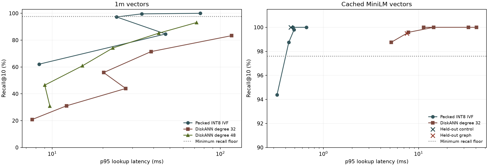

# Retrieval speed, phase 2

Direct, two-worker INT8 scanning lowered 10m p95 lookup latency from
**543.04 ms to 151.66 ms** under the same 1536 MiB process working-set policy.
The new path was **3.58× faster** and returned identical scores and ordered IDs
at **97.66% Recall@10**. The DiskANN settings tested at 1m missed the required
recall and the native path provided the speed gain.

## Disk graph result

No tested graph setting qualified on the 1m synthetic tuning split. The graph
with the highest recall reached 93.125% at 72.175 ms p95. Under the INT8
control's latency budget, the best graph recall was 74.167%. The graph was
evaluated only on the tuning split at this scale, since no setting reached
the 97.6% minimum. The 10m graph build was skipped under that quality gate.

| 1m, 48 tuning queries | p95 milliseconds | Recall@10 |
| --- | ---: | ---: |
| Packed INT8, 24 probes | 24.122 | 97.292% |
| DiskANN, degree 48, complexity 256, beam 4 | 22.956 | 74.167% |
| DiskANN, degree 48, complexity 1024, beam 8 | 72.175 | 93.125% |

The degree-32 and degree-48 graph builds took respectively 309.5 and 433.7
seconds inside the native builder. The index bundles plus the ID map occupied
764 and 809 MB. Peak builder residency was about 2.15 GiB for each, including
adapter setup and reopen. Both had the same 1.5 GiB algorithm build setting.
That setting guides construction and the query working-set cap is applied
separately. The graph sizes exclude the temporary vector export.

The 100k pilot established feasible graph construction and reopen. The pilot
graph reached 73.125% Recall@10 at complexity 128 and beam 2. Its native
construction took 42.6 seconds. The initial one-slot reopen attempts and
their logs remain in the local run directory.



## Cached real embeddings

The separate MiniLM SciFact check used 3,328 cached 384D vectors and 100
held-out queries over three rounds. Graph search reached 99.5% Recall@10 at
7.532 ms p95. Packed INT8 reached 100% at 0.455 ms in that comparison.
The direct native ablation also returned 100% recall in each arm. It
measured 0.597 ms cached, 0.525 ms direct with one worker and 1.193 ms with
two. On this small collection, the added worker increased p95. These
measurements use nearest-neighbor recall over cached embeddings.

## Native INT8 fallback

The opt-in path scores encoded rows directly from the immutable mapping.
It divides the selected candidates evenly across the requested number of
workers. Each worker builds a local shortlist using the existing score and
ID ordering. The query merges those shortlists once and runs the same FP32
rerank on the result. Block-cache statistics still count rerank reads. The
direct scan uses the OS mapping and does not populate Vortex's block cache.

The 1m fallback comparison used 100 held-out queries over three rounds.
It measured 51.432 ms p95 for cached INT8, 14.194 ms for direct INT8 with
one worker and 10.452 ms with two workers. All 300 paired calls had the
same ordered IDs and scores with identical scan counts. Recall@10 was
96.9% for every arm on this split. This is exact agreement with the
existing approximate search and FP32 rerank behavior, independent of
the separate quality floor used to select a graph configuration.

The 100k pilot had 32 held-out queries and one round. It measured p95 of
2.219 ms cached, 1.728 ms direct with one worker and 2.041 ms with two.
The second worker adds scheduling overhead on small collections.

| Held-out corpus | Cached p95 ms | Direct, one worker p95 ms | Direct, two workers p95 ms | Two-worker speedup | Recall@10, all arms |
| --- | ---: | ---: | ---: | ---: | ---: |
| 100k | 2.219 | 1.728 | 2.041 | 1.09× | 94.38% |
| 1m | 51.432 | 14.194 | 10.452 | 4.92× | 96.90% |
| 10m | 543.044 | 301.710 | 151.664 | 3.58× | 97.66% |

The 10m result used 64 distinct held-out queries over two rounds. All 128
paired calls returned identical ordered results and scored the same rows,
averaging 7,502,252 candidates per query. The median and p95 correspond to
single API calls. The speedup was 3.52–3.63× in the paired-query bootstrap
interval and the pooled p95 reduction was 72.1%. The optimized and cached
workers peaked at 1429.0 and 1428.5 MiB respectively. The snapshot and index
open path are shared. In a separately timed serial request stream, the two
optimized rounds sustained 7.03 and 7.09 queries per second, versus 1.87 and
1.98 for cached INT8.

This experiment uses a fresh query split and cached INT8 control. The 97.66%
recall differs from the earlier 98.1% result on a different split. Direct
scanning changes how candidates are read and scored in parallel, with
identical recall on the directly paired queries.

```python
from vortex import Index

index = Index.open("packed-int8.vtx", threads=2)
result = index.search(query, k=10, nprobe=24, rerank_n=100, scan_threads=2)
```

Use `scan_threads=1` for direct serial scanning or the default `0` for
cached scanning. Direct scans require an open mapped INT8 snapshot and
at least as many configured worker slots as requested. The version-1 file
format, default query and batch API remain compatible.

## Method

The INT8 control searches 24 of 32 lists and reranks 100 candidates against
the original FP32 vectors. The graph starts from those same FP32 vectors and
returns ten neighbors with squared L2 scores. The benchmark adapter translates
graph row numbers back to the snapshot's public uint64 IDs inside the measured
call. DiskANN uses in-memory PQ routing codes and reads its graph and FP32
vectors from the disk index. Graph misses and returned neighbor counts are
recomputed against independently generated exact references. The Python disk
API exposes no per-query graph visit counter, so the measurements retain
process I/O observations and leave graph candidate counts empty.

Both backends run on Windows with two configured thread slots and one query
submitted at a time, with a separate batch measurement. The requested resident
working-set maximum is 1536 MiB for each query worker. The prior 64 KiB
accounting allowance applies. Each backend runs in its own process. Build
memory and preparation time are measured separately. Cache conditions are
warmed with three queries and otherwise managed by the OS and the respective
backends. This is a workstation lookup benchmark with fixed precomputed
vectors and queries.

Use the [declared protocol](../benchmarks/phase2_protocol.md) for query counts,
quality gates and resource limits. The routing sweep uses its own query split.
Selection is frozen before held-out lookup. Matched comparisons use identical
query order within a round and alternate backend order across rounds.
Confidence intervals resample paired query IDs, retaining repeats together.
The intervals describe this workload and do not estimate differences across
hardware or deployment environments.

DiskANN 0.7.0 is tested in an isolated Python 3.11 environment. This wheel
requires NumPy 1.25, while the main Vortex package declares NumPy 1.26 or
above. The control is built directly from the Vortex sources into that same
benchmark runtime. One-thread disk reopen stalled twice at medoid
initialization in the Windows wheel. A fresh process with two slots reopened
the graph and returned results. The matching two-slot protocol was declared
before timed graph comparisons. See the
[DiskANN Python API](https://microsoft.github.io/DiskANN/docs/python/latest/diskannpy.html)
and upstream [single-thread search issue](https://github.com/microsoft/DiskANN/issues/462)
for context. The upstream issue does not establish the cause of this local
stall.

## Reproduce

From the Vortex root, create a separate benchmark environment. The commands
below use the Windows GCC and Ninja toolchain used by the study. Customize the
compiler and Ninja paths for another installation.

```powershell
uv venv --python 3.11 .work/phase2-env
$studyPython = '.work/phase2-env/Scripts/python.exe'
uv pip install --python $studyPython 'diskannpy==0.7.0' 'faiss-cpu==1.9.0.post1' 'psutil==7.1.3' 'pybind11==3.1.0' 'pytest==8.4.2'
.venv/Scripts/cmake.exe -S . -B build-phase2 -G Ninja -DCMAKE_BUILD_TYPE=Release -DVORTEX_PYTHON=ON -DPython_EXECUTABLE="$PWD/.work/phase2-env/Scripts/python.exe" -DCMAKE_MAKE_PROGRAM="$PWD/.venv/Scripts/ninja.exe" -DCMAKE_CXX_COMPILER=C:/msys64/ucrt64/bin/g++.exe
.venv/Scripts/cmake.exe --build build-phase2 --parallel 2
$env:PYTHONPATH = 'build-phase2/python;python;benchmarks'
$env:OMP_NUM_THREADS = '2'
$env:OPENBLAS_NUM_THREADS = '1'
& $studyPython -m pytest tests/test_phase2_diskann.py -q
& $studyPython benchmarks/study_retrieval_phase2.py 1m results/performance-20261119-v1/1m/packed-int8.vtx results/phase2-reproduction/1m --degrees 32 48 --seconds 2400 --build-seconds 960
```

The study accepts an existing packed INT8 L2 snapshot. When that snapshot
is unavailable, generate the seeded corpus with
`benchmarks/prepare_performance_data.py`, repack the IVF lists with
`benchmarks/repack_snapshot.py`, and encode the resulting snapshot with
`benchmarks/encode_snapshot.py --dtype int8`. The source snapshot hash is
recorded for each run. Use fresh output directories.

The benchmark driver retains graph build logs and manifests, independent query
and reference arrays, every timed query, ordered hits, configuration, and
build and input hashes under the output root. Recompute and verify the
measurements with the repository environment that has Matplotlib installed.

```powershell
$env:PYTHONPATH = 'python;benchmarks'
.venv/Scripts/python.exe benchmarks/report_retrieval_phase2.py results/phase2-reproduction --summary results/phase2-reproduction/summary.json --figure results/phase2-reproduction/recall-latency.png
```

For the native ablation, build the current sources in `build-phase2-int8`
with the same CPython and CMake flags, then reuse the graph stage's exact
reference. Every native arm imports the same compiled module.

```powershell
.venv/Scripts/cmake.exe -S . -B build-phase2-int8 -G Ninja -DCMAKE_BUILD_TYPE=Release -DVORTEX_PYTHON=ON -DPython_EXECUTABLE="$PWD/.work/phase2-env/Scripts/python.exe" -DCMAKE_MAKE_PROGRAM="$PWD/.venv/Scripts/ninja.exe" -DCMAKE_CXX_COMPILER=C:/msys64/ucrt64/bin/g++.exe
.venv/Scripts/cmake.exe --build build-phase2-int8 --parallel 2
& $studyPython benchmarks/study_parallel_int8.py results/performance-20261119-v1/1m/packed-int8.vtx results/phase2-reproduction/1m/reference results/phase2-reproduction/native-1m --offset 48 --count 100 --rounds 3 --seconds 480
& $studyPython benchmarks/run_performance.py reference --snapshot results/performance-20261119-v1/10m/packed-int8.vtx --output results/phase2-reproduction/native-10m-reference --count 112 --seed 20261124
& $studyPython benchmarks/study_parallel_int8.py results/performance-20261119-v1/10m/packed-int8.vtx results/phase2-reproduction/native-10m-reference results/phase2-reproduction/native-10m --offset 48 --count 64 --rounds 2 --seconds 900
```

Use `--module-dir` to select a different native module directory. The native
driver alternates mode order by round and verifies identical hits, scores
and scan counts. It runs a separate stream of single-query calls for
throughput. The graph probe uses the backends' batch interfaces.

The [audited summary](../benchmarks/reference/retrieval-phase2/summary.json)
contains per-case hashes and statistics for 4,224 timed calls, including
1,944 graph-study and 2,280 native ablation calls. The current study's raw
measurements and build outputs are retained locally under
`results/retrieval-phase2-20261119-v1`. The phase 1 evidence remains available
in its original archive. The measured machine was an Intel Core i7-1255U
with 16 GB RAM and NVMe storage, using GNU 16.1.0 Release and the AVX2 kernel.

The rebuilt package passed 169 Python tests. The optional graph fixture was
skipped in that environment and passed separately alongside the seven native
regressions in the Python 3.11 study environment. Windows CTest passed with
63,743 assertions. Ubuntu AddressSanitizer and UndefinedBehaviorSanitizer
CTest passed. The prior performance, capacity, scaling and RAG evidence
validators also passed.

## CV wording

> Reduced p95 retrieval latency 72.1% on a 10-million-vector INT8 benchmark
> by parallelizing direct memory-mapped scans, preserving identical results
> and 97.66% Recall@10.
