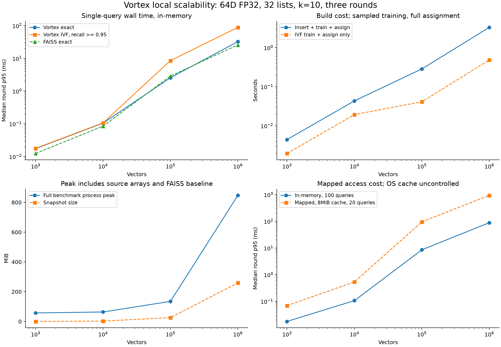

# Vortex local scalability results

This page preserves the historical in-memory 1k-to-1m experiment. A separate
[10m single-collection mapped experiment](capacity_10m.md) uses streamed
construction and a resident-memory policy; its timings are kept separate.

All four requested corpus sizes were attempted in isolated local processes, without a cloud service. The unchanged installed engine was exercised with synthetic 64-dimensional FP32 vectors. This is a fixed-configuration scale experiment, not a claim about all embedding dimensions or production workloads.

## Configuration and method

- Recorded environment: Intel64 Family 6 Model 154 Stepping 4, GenuineIntel; Windows-11-10.0.26300-SP0; AMD64.
- Engine build: installed 0.1.0 native extension; GNU 16.1.0 MinGW UCRT; CMake Release -O3; static runtime; runtime AVX2 available: True.
- Sizes: 1,000; 10,000; 100,000; 1,000,000. Identical seeded corpus prefixes and the same independent query set.
- Metric: squared L2; dimension 64; k=10; nlist fixed at 32; eight clustering iterations; at most 10,000 training samples followed by assignment of every corpus vector.
- Single-query latency: 100 distinct queries, three randomized-order rounds, five warm-ups per configuration. Tables use the median of the three round p95 values. These are repetitions of one dataset, not independent corpora or independent machines.
- IVF sweep: nprobe 1, 4, 8, 16, 24, 28, 32. The reported operating point is the smallest prespecified probe reaching mean Recall@10 >= 0.95 on the measured queries. No independent tuning split was used.
- Validation: repeated output stability; all-list IVF/exhaustive agreement; independent float64 NumPy checks on three query IDs per corpus; FAISS exact-neighbor comparison on all measured queries; saved-index round-trip checks; cache payload bound.
- FAISS Flat: same arrays, metric and k, one thread. Its Python adapter differs from Vortex, which copies validated input and constructs Python result records. Timings were not collected in a randomized interleaving of implementations.
- Four-worker throughput uses full batch wall time and must not be confused with single-query latency or a network service's sustained QPS.

## In-memory results

| Vectors | Insert + IVF build (s) | Exact p95 (ms) | IVF p95 (ms) | Recall@10 | nprobe | Process peak MiB |
| ---: | ---: | ---: | ---: | ---: | ---: | ---: |
| 1,000 | 0.004 | 0.017 | 0.018 | 0.991 | 24 | 57.1 |
| 10,000 | 0.043 | 0.105 | 0.107 | 0.956 | 24 | 63.7 |
| 100,000 | 0.286 | 2.573 | 8.555 | 0.971 | 24 | 134.8 |
| 1,000,000 | 3.299 | 32.575 | 88.578 | 0.978 | 24 | 847.2 |

Peak memory is the process-wide Windows working-set high-water mark, including the generated NumPy matrix, builder, temporary reference calculations, FAISS baseline and mapped pages. It is not engine-only RAM and does not include the operating system's entire file cache. Each size ran in a separate process to avoid carrying the preceding process's peak forward.

## Persistence and mapped access

| Vectors | Snapshot MiB | Open mapped (s) | Mapped IVF p95 (ms) | Mapped Recall@10 | Four-worker exact batch QPS |
| ---: | ---: | ---: | ---: | ---: | ---: |
| 1,000 | 0.27 | 0.010 | 0.070 | 0.995 | 133422.3 |
| 10,000 | 2.60 | 0.021 | 0.536 | 0.965 | 23945.8 |
| 100,000 | 25.95 | 0.028 | 95.379 | 0.970 | 1236.8 |
| 1,000,000 | 259.41 | 0.127 | 936.460 | 0.985 | 118.8 |

Mapped IVF uses the same selected nprobe, but a 20-query subset and three repetitions. The original builder/source matrix are released before reopening. The explicit cache has an 8 MiB payload limit. The operating-system page cache is not flushed, and files were recently written, so these are not physical cold-SSD measurements. A collection larger than this explicit cache is not necessarily larger than physical RAM.

## Interpretation

- Completing a one-million-vector test establishes that this particular 64D configuration works locally. It does not establish billion-vector capacity, multi-node scaling, or real-model RAG quality.
- High-recall IVF can be slower than exact scans here. Independent random vectors have weak cluster structure, the fixed 32-list setup needs many probes, and list traversal has less favorable memory access. Lower-probe speed should always be shown with its lower recall.
- No per-size search for the optimal cluster count was performed. Index tuning and cache/layout changes may improve performance, but improvements are not assumed in these measurements.
- One million 768D FP32 vectors would require 3.072 GB for just the raw vector components. This 64D result does not validate that larger-memory configuration on the currently busy machine.
- Cloud infrastructure was not required. More available RAM or a cloud instance would help test higher dimensions, collections beyond physical RAM, and sustained isolated service load.



## Reproduction and evidence

Validate the published archive and regenerate its tables/chart without repeating the measurements:

```bash
python benchmarks/validate_scaling.py
python benchmarks/report_scaling.py --input-dir benchmarks/reference/scaling --output-dir results/scaling-report
```

To collect a new dataset in isolated processes, run from the repository root using an environment containing the installed native package, NumPy, FAISS and Matplotlib:

```bash
python benchmarks/run_scaling.py --output results/scaling-new
python benchmarks/report_scaling.py --input-dir results/scaling-new --output-dir results/scaling-new/report
```

The JSON result in each size directory records build stages, per-configuration percentiles, recall, memory stages, dataset/source fingerprints, package versions, source revision and runner hash. The corresponding queries.jsonl preserves all timed query results. Snapshot files are retained locally. Summary CSV/JSON and plots are derived from these records. The archived runner_snapshot.txt preserves the exact historical runner bytes; the maintained runner includes CLI validation and evidence-preservation improvements. Working-tree dirty flags in the original manifests include incidental untracked local files and do not represent native-engine changes.

Large snapshots remain local under the ignored /results/ directory. The published JSON/query logs preserve the original measurements. The native engine was not modified for these tests; subsequent changes package the harness, evidence and reports.


## Published evidence

- [Manifest, original runner and checksums](../benchmarks/reference/scaling/README.md).
- [Summary CSV](../benchmarks/reference/scaling/summary.csv) and [JSON](../benchmarks/reference/scaling/summary.json).
- Per-size results and query records: [1k](../benchmarks/reference/scaling/1000/), [10k](../benchmarks/reference/scaling/10000/), [100k](../benchmarks/reference/scaling/100000/) and [1m](../benchmarks/reference/scaling/1000000/).
